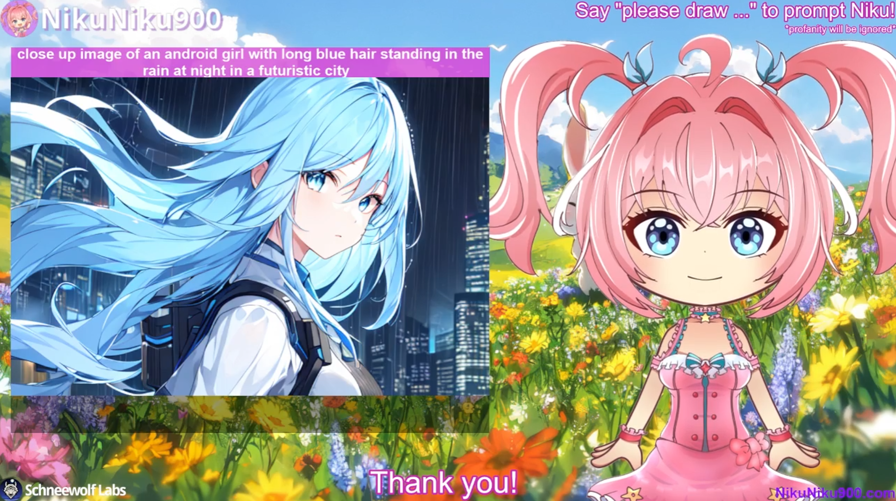

# Chatty

> A powerful, extensible framework for connecting AI language models to chat services like Twitch and Discord.



[](https://www.gnu.org/licenses/gpl-3.0)
[](https://www.typescriptlang.org/)
[](./TESTING_SUMMARY.md)

## Overview

Chatty is a comprehensive TypeScript framework that bridges AI language models with popular chat platforms. It provides intelligent message processing, content filtering, and multi-modal output capabilities, making it ideal for creating engaging AI-powered chat experiences.

## Features

### Chat Platform Integration
- **Twitch** - Full integration with tmi.js for Twitch chat
- **Discord** - Complete Discord.js support with server and DM capabilities
- **Extensible Architecture** - Easy to add new platforms

### AI & Language Processing
- **Oobabooga API Integration** - Connect to local or remote LLM instances
- **Streaming Response Support** - Real-time token streaming with intelligent chunking
- **Context Management** - Automatic chat history and persona management
- **Profanity Detection** - Built-in content filtering with customizable thresholds
- **Sentiment Analysis** - Message sentiment evaluation for better responses

### Content Generation
- **Text-to-Speech** - Windows TTS integration via [WinTTS](https://github.com/Schneewolf-Labs/WinTTS-Stream)
- **Image Generation** - Automatic1111 Stable Diffusion integration
- **Multi-Modal Output** - Text, image, and audio file generation for OBS integration

### Developer Features
- **RESTful API** - Built-in API for monitoring and control
- **Comprehensive Testing** - 289 unit tests with >80% coverage
- **TypeScript** - Fully typed for better IDE support and fewer bugs
- **Flexible Configuration** - YAML-based configuration system
- **Event-Driven Architecture** - Easy to extend and customize

## Quick Start

### Prerequisites
- [Node.js](https://nodejs.org/) v18.0.0 or higher
- [Git](https://git-scm.com/)
- An LLM API endpoint (e.g., [Oobabooga Text Generation WebUI](https://github.com/oobabooga/text-generation-webui))

### Installation

1. **Clone the repository**
   ```bash
   git clone https://github.com/Schneewolf-Labs/Chatty.git
   cd Chatty
   ```

2. **Install dependencies**
   ```bash
   npm install
   # or
   yarn install
   ```

3. **Configure environment variables**

   Create a `.env` file in the root directory:
   ```env
   # Twitch Configuration (optional)
   TWITCH_USERNAME=your_bot_username
   TWITCH_OAUTH_TOKEN=oauth:your_oauth_token
   TWITCH_CHANNEL=channel_to_join

   # Discord Configuration (optional)
   DISCORD_TOKEN=your_discord_bot_token
   ```

4. **Set up your configuration**

   Edit `config.yml` to configure features and behavior (see [Configuration Guide](./CONFIGURATION.md))

5. **Create a persona file**

   Create `persona.yaml` in the root directory:
   ```yaml
   name: Assistant
   greeting: Hello! How can I help you today?
   context: |
     I am a helpful AI assistant. I'm friendly, supportive, and always ready to help.
     I enjoy chatting with people and providing useful information.
   ```

6. **Build and run**
   ```bash
   npm run build
   npm start
   ```

   For development with auto-reload:
   ```bash
   npm run dev
   ```

## Configuration

Chatty uses a YAML configuration file (`config.yml`) for all settings. Key configuration sections include:

### Platform Configuration
```yaml
twitch:
  enabled: true
  chat-enabled: true
  reply-in-chat: true

discord:
  enabled: true
  chat-enabled: true
  channels: []  # Specific channel IDs, or empty for all
  allow-dms: true
```

### Message Processing
```yaml
messages:
  max-tokens: 1000                    # Maximum context window
  response-interval: 3500             # Cooldown between responses (ms)
  chat-history-length: 8              # Messages to keep in context
  require-wake-word: false            # Require mention to respond
  wake-words: ["@bot", "hey bot"]     # Wake word triggers
```

### Content Filtering
```yaml
messages:
  profanity-check: true
  profanity-threshold: 0.5
  negativity-threshold: -3.5
```

For complete configuration documentation, see [CONFIGURATION.md](./CONFIGURATION.md).

## API Integration

### Oobabooga Setup
```yaml
oobabooga:
  enabled: true
  host: "localhost"
  port: 5000
  streaming: true
```

### Stable Diffusion Setup
```yaml
stable_diffusion:
  enabled: true
  host: "localhost"
  port: 7860
  trigger: "please draw"
```

## Voice Synthesis (TTS)

Chatty supports Windows TTS via [WinTTS](https://github.com/Schneewolf-Labs/WinTTS-Stream):

1. Install [.NET 6.0 Runtime](https://dotnet.microsoft.com/download/dotnet/6.0)
2. Download WinTTS executable
3. Configure in `config.yml`:
   ```yaml
   voice:
     enabled: true
     wintts_path: "path/to/WinTTS.exe"
     output_device: "Speakers"
   ```

## API Reference

Chatty includes a built-in REST API for external control and monitoring.

### Enable the API
```yaml
api:
  enabled: true
  port: 3000
```

### Send a Message
```http
POST http://localhost:3000/
Content-Type: application/json

{
  "event": "send_message",
  "data": "Hello, Chatty!"
}
```

### Receive Response
```json
{
  "event": "receive_message",
  "data": "Hi there! How can I help you?"
}
```

For complete API documentation, see [API_REFERENCE.md](./API_REFERENCE.md).

## Development

### Project Structure
```
Chatty/
├── src/
│   ├── api/          # REST API implementation
│   ├── chat/         # Chat platform integrations
│   │   ├── message/  # Message processing
│   │   └── response/ # Response generation
│   ├── client/       # Platform clients (Discord, Twitch)
│   ├── draw/         # Image generation
│   ├── voice/        # TTS integration
│   └── util/         # Utilities and helpers
├── config.yml        # Main configuration
├── persona.yaml      # AI persona definition
└── output/          # Generated content (OBS integration)
```

### Running Tests
```bash
# Run all tests
npm test

# Run tests once
npm run test:run

# Run with coverage
npm run test:coverage

# Run with UI
npm run test:ui
```

See [TEST_GUIDE.md](./TEST_GUIDE.md) for testing documentation.

### Code Quality
```bash
# Type checking
npm run typecheck

# Linting
npm run lint

# Build
npm run build
```

## Contributing

We welcome contributions! Please see [CONTRIBUTING.md](./CONTRIBUTING.md) for guidelines.

### Development Workflow
1. Fork the repository
2. Create a feature branch (`git checkout -b feature/amazing-feature`)
3. Write tests for your changes
4. Ensure all tests pass (`npm test`)
5. Commit your changes (`git commit -m 'Add amazing feature'`)
6. Push to the branch (`git push origin feature/amazing-feature`)
7. Open a Pull Request

## License

This project is licensed under the GNU General Public License v3.0 - see the [LICENSE](LICENSE) file for details.

## Acknowledgments

- [Oobabooga](https://github.com/oobabooga/text-generation-webui) - Text generation WebUI
- [Discord.js](https://discord.js.org/) - Discord API wrapper
- [tmi.js](https://tmijs.com/) - Twitch messaging interface
- [Automatic1111](https://github.com/AUTOMATIC1111/stable-diffusion-webui) - Stable Diffusion WebUI

## Support

- **Documentation**: Check out our [documentation](./docs)
- **Issues**: [GitHub Issues](https://github.com/Schneewolf-Labs/Chatty/issues)
- **Discussions**: [GitHub Discussions](https://github.com/Schneewolf-Labs/Chatty/discussions)

## Roadmap

- [ ] Support for additional chat platforms (Slack, Matrix)
- [ ] Plugin system for custom extensions
- [ ] Web-based configuration UI
- [ ] Docker containerization
- [ ] Cloud deployment guides
- [ ] Advanced memory and RAG integration

---

Made with ❤️ by [Schneewolf Labs](https://github.com/Schneewolf-Labs)
